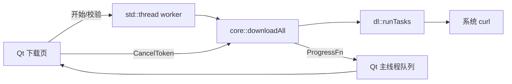

## 用户需求

将下载页当前由内嵌 Python 脚本执行的下载任务，改为随主程序编译的原生实现，不再在运行时释放或调用 Python 脚本。

## 产品概述

下载页的交互、进度显示、日志、取消按钮、镜像选择、SHA1 校验、断点缓存和“校验已装文件”能力保持不变，仅替换下载器实现，使用户无需安装 Python 即可下载和修复游戏文件。

## 核心功能

- 获取 Mojang 版本清单，支持正式版列表、预览版列表和最新预览版。
- 下载版本 json、client jar、libraries、asset index/assets 以及 Mojang Java runtime。
- 按加载器架构过滤 natives，按镜像规则替换下载地址。
- 多线程下载，校验 SHA1，失败重试，保留 `.part` 临时文件并在完成后原子替换。
- 下载进度实时显示，失败项写入日志，支持中途取消且不留下损坏文件。
- “校验已装文件”只读取本地版本 json，检查 jar、libraries、assets，统计异常并补下缺失或损坏文件。
- 保留现有下载目录结构、镜像规则、组件选择和校验语义。

## 技术栈

- 语言与框架：继续使用项目现有的 C++23 + Qt6 Widgets，不引入 C、Rust 或 C# 运行时。
- 下载后端：继续使用系统 `curl` CLI；本轮不引入 libcurl，避免新增开发包和动态库依赖。
- 构建方式：沿用 Makefile，单 ELF 输出，不增加辅助运行时二进制。
- 测试：C++ 测试 harness + 现有 `tests/mock_cdn.py` 离线 mock CDN；`python3` 仅保留为测试/构建工具，不再作为运行时依赖。

## 实现方案

### 核心策略

项目中已经存在一份未接入 UI 的 C++ 下载实现：`include/launcher_core.hpp` 的 `downloadAll()`，以及 `include/download.hpp` 的 SHA1、镜像替换、`curlGet()`、`Task` 和 `runTasks()`。本次不重写下载器，而是补全并激活这套实现：

1. 扩展 `download.hpp`：

- `curlGet()` 增加取消检查：父进程用 `waitpid(WNOHANG)` 轮询，取消时先 `SIGTERM`，超时再 `SIGKILL`。
- 对 `127.0.0.1` / `localhost` 自动追加 `--noproxy`，保证离线 mock CDN 和自建镜像不被系统代理拦截。
- 增加 `probeFile()` 和并行 `probeTasks()`，用于 verify 阶段统计 missing/bad，避免几万个 assets 单线程重复 SHA1。
- `runTasks()` 支持取消：取消后不再领取新任务，正在执行的 curl 被杀掉，`.part` 由调用方清理。

2. 补全 `launcher_core.hpp`：

- 增加 `DownloadMode`（Install / Verify）、`DownloadOptions`（mode、测试用 limit）和 `DownloadResult`（ok、cancelled、checked、bad、downloaded、cached、failed、error）。
- `downloadAll()` 支持 verify 模式：只信本地版本 json，检查 jar/libraries/assets，统计异常并补下；runtime 不参与 verify。
- 修正错误语义：版本清单、版本 json、asset index、runtime 清单等关键元数据失败时返回明确错误；单文件失败汇总为 `failed`；取消单独标记为 `cancelled`，不伪装成普通失败。
- 元数据缓存目录统一为 `layout_.configDir / "cache"`，与现有“清除下载缓存”一致。
- 扩展 `onlineVersions()` 支持 snapshots 和数量上限；新增 `latestSnapshot()` 读取 `latest.snapshot`。
- 保留现有 `Layout` 路径和目录结构，不改变 `versions/`、`libraries/`、`assets/`、`runtime/` 布局。

3. Qt UI 接入：

- 删除 `kDownloaderPy`、`saveDownloaderScript()`、`pythonBin()`、`scriptPath_`、`downloadProc_`、`buffer_`、`onDownloadOutput()`。
- `startDownload()` 和 `verifyInstalled()` 改为在 `std::thread` 中调用 `core::downloadAll()`。
- 使用 `QPointer<LauncherWindow>` + `QMetaObject::invokeMethod(..., Qt::QueuedConnection)` 把进度和完成结果切回主线程。
- 用 `std::shared_ptr<std::atomic_bool>` 作为取消令牌，worker 和窗口共享生命周期；关闭窗口或点取消只置位令牌，不直接操作 worker 对象。
- 增加运行序号，忽略上一次任务迟到的进度/完成回调，避免取消后立刻重开时旧事件污染新任务。
- 进度在 worker 侧按 100ms、阶段切换、失败事件和最终事件节流，避免数千个文件产生海量 queued 调用。
- 保留现有按钮文案和日志格式；完成后刷新本地版本和 Java。

4. 性能考虑：

- 默认 10 个并发任务，复用现有 `runTasks()` 线程池，最多 16。
- SHA1 使用 1MB 流式缓冲，避免整文件读入内存。
- verify 先并行探测，只对 broken 列表执行下载，避免“探测一次、下载时又校验一次”的双重开销。
- 继续使用 curl CLI 的主要代价是每文件一次 `fork/exec`；在当前并发和网络 IO 占主导的场景下可控。若后续实测出现明显退化，再单独评估 libcurl 或批量 curl，不作为本次范围。

5. 安全与可靠性：

- 继续通过 `fork + execvp` 传 argv，不经过 shell，避免命令注入。
- 所有下载文件先写 `.part`，SHA1 通过后再 `rename`，失败/取消时删除临时文件。
- runtime 可执行文件保持 `0755`，普通文件 `0644`。
- 错误信息只包含 URL、路径和 curl 退出码，不输出敏感环境变量。

## 架构设计



## 目录结构

```text
mc26-one/
├── include/
│   ├── download.hpp                    # [MODIFY] 增加 curl 取消、--noproxy、probeFile/probeTasks；保持 SHA1、镜像和 Task 结构
│   └── launcher_core.hpp               # [MODIFY] 补全 DownloadOptions/DownloadResult、verify 模式、onlineVersions snapshots、latestSnapshot、错误语义
├── src/
│   └── mc263_qt.cpp                    # [MODIFY] 删除内嵌 Python 与 QProcess 下载链路，改为线程内调用、进度节流、取消令牌和运行序号
├── tests/
│   ├── downloader_test.cpp             # [NEW] C++ 下载器测试 CLI，调用 core::downloadAll/onlineVersions，输出 JSON 进度和退出码
│   ├── downloader_test.sh              # [MODIFY] 不再抽取 Python 脚本，改为构建并运行 C++ harness，覆盖下载/verify/取消/在线版本
│   └── mock_cdn.py                     # [MODIFY] 增加 snapshot 条目和慢速端点，供列表与取消测试使用
├── Makefile                            # [MODIFY] 增加 build/downloader-test 目标，并纳入 make check
├── packaging/
│   ├── mc263-source.spec               # [MODIFY] 移除运行时 python3，显式 Requires curl；保留测试所需 BuildRequires python3；更新描述与 changelog
│   ├── mc263.spec                      # [MODIFY] 预编译包移除 python3，增加 curl，更新描述
│   ├── build-deb.sh                    # [MODIFY] Depends 移除 python3，保留 curl；更新包描述和依赖检查
│   ├── PKGBUILD                        # [MODIFY] depends 移除 python，保留 curl；测试依赖单独声明
│   ├── build-rpm.sh                    # [MODIFY] 更新“需要 python3”的提示
│   └── build-arch.sh                   # [MODIFY] 区分运行时依赖与测试依赖，移除运行时 python
├── README.md                           # [MODIFY] 更新依赖、目录树、make check 说明，删除 mc263_downloader.py 描述
└── docs/
    ├── arch-handoff.md                 # [MODIFY] 更新 Arch 依赖表和下载器说明
    └── debian-handoff.md               # [MODIFY] 更新 Debian 依赖表和下载器说明
```

## 关键代码结构

```cpp
enum class DownloadMode { Install, Verify };

struct DownloadOptions {
    DownloadMode mode = DownloadMode::Install;
    size_t limit = 0;  // 0 表示不限制；仅测试使用
};

struct DownloadResult {
    bool ok = false;
    bool cancelled = false;
    size_t checked = 0;
    size_t bad = 0;
    size_t downloaded = 0;
    size_t cached = 0;
    size_t failed = 0;
    std::string error;
};
```

## 实施注意

- `startDownload()` 当前使用 `downloadVersion_->currentText()`，不能直接用 `cfg_.version`；应复制一份 `core::Config job = cfg_`，把 `job.version` 设为下载页选中的版本后再传给 `downloadAll()`。
- `verifyInstalled()` 应固定组件为 `jar,libraries,assets`，与现有 Python 行为一致，不校验 runtime。
- `downloadAll()` 的 `limit` 只用于测试 assets/runtime，生产路径传 0。
- `curlGet()` 取消后必须回收子进程并删除 `.part`，避免残留文件被下次误判为缓存。
- 进度回调运行在 worker 线程，绝不能直接调用 Qt 控件；所有 UI 更新必须 queued 到主线程。
- 保留现有日志频率：每 50 项或失败时写日志，避免几万条 assets 日志拖慢界面。
- 不修改下载目录、镜像规则、SHA1 规则和 UI 视觉；本次只替换执行方式。